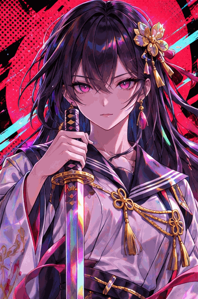
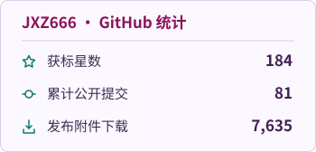

<h1 align="center">我是菊千代赛高</h1>

  <code>JXZ666</code> 
  

  

学电气的大学生一枚，没事喜欢自己瞎捣鼓点东西

  
  
  
  

  

<h2 align="center">正在折腾的作品</h2>

<!-- 新增作品时，复制一个项目标题及简介，更新仓库链接并追加到本节末尾。 -->

<h3 align="center"><a href="https://github.com/JXZ666/slgking">slgking</a></h3>

「黄油之王」提供游戏目录检索与本地游戏库管理。

<h3 align="center"><a href="https://github.com/JXZ666/SLG-Renpy-Toolkit">SLG-Renpy-Toolkit</a></h3>

为 Ren’Py / RPG Maker 游戏提供字体与兼容补丁。

<h3 align="center"><a href="https://github.com/JXZ666/echoes-of-the-abyss">《深渊回响》</a></h3>

原创工业奇幻世界中的文字冒险 RPG。

  

<h2 align="center">GitHub 统计</h2>

  <picture>
    <source media="(prefers-color-scheme: dark)" srcset="./assets/stats-dark.svg">
    
  </picture>

  

<h2 align="center">联系我</h2>

  邮箱 <a href="mailto:jxzsaikou666@qq.com">jxzsaikou666@qq.com</a> 
  QQ 项目交流群 <code>1124074040</code>

